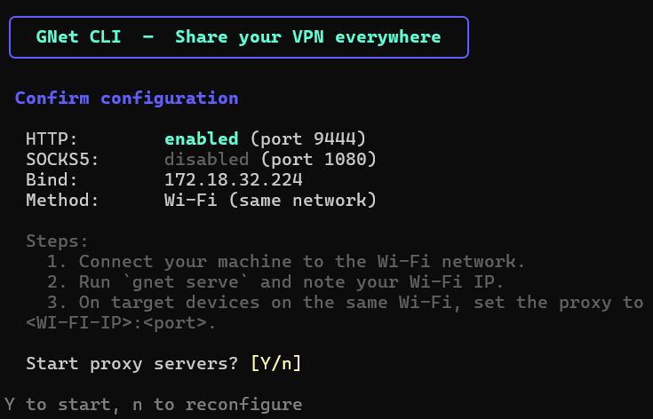

<div align="center">

English | [فارسی](README_FA.md)

# 🌐 GNet CLI

**Share your VPN over HTTP/SOCKS5 to any device on your network.**

Turn your machine into a lightweight proxy server so phones, tablets, smart TVs, and other devices can route traffic through your VPN — over LAN, Wi-Fi, hotspot, USB, or router.


[](https://github.com/frank-vpl/gnet-cli/actions/workflows/build.yaml)
[](https://github.com/frank-vpl/gnet-cli/releases/latest)

[⬇️ Download](#️-download) · [🚀 Quick Start](#-quick-start) · [📚 Commands](#-commands) · [🔌 Sharing Methods](#-sharing-methods)

</div>

---

## 🖼️ Screenshot

<p align="center">
  
</p>

*The interactive setup wizard — choose proxy type, ports, bind address, and sharing method in seconds.*

---

## ✨ Features

- 🔁 **HTTP & SOCKS5 Proxy** — Run one or both simultaneously with custom ports.
- 🧙 **Interactive Wizard** — A polished TUI walks you through setup step by step.
- 🛡️ **Firewall Automation** — Auto-creates firewall rules on **Windows, Linux (ufw/firewalld/nftables/iptables), and macOS** (or gives copy-paste commands).
- 📡 **Auto IP Detection** — Shows every reachable address so devices can connect.
- 🔌 **5 Sharing Methods** — LAN, Wi-Fi, Hotspot (AP), USB Tethering, Router Port Forward.
- 💾 **Persistent Config** — Saves your settings to `~/.gnet-cli/config.json`.
- 🐛 **Debug Logging** — Optional file logging and live connection tracking.
- ⏹️ **Graceful Shutdown** — Cleanly closes listeners and active connections.

---

## 📦 Installation

### Build from source

```bash
git clone https://github.com/frank-vpl/gnet-cli.git
cd gnet-cli
go build -o gnet .
```

> On Windows, the output is `gnet.exe`. Add the directory to your `PATH` or run it directly.

### Requirements

- [Go](https://go.dev/) 1.27 or later

---

## ⬇️ Download

Grab the latest pre-built binary for your platform — no Go installation required.

| Platform | Architecture | Download |
|----------|-------------|----------|
| 🪟 Windows | x64 | [](https://github.com/frank-vpl/gnet-cli/releases/latest/download/gnet-windows-x64.zip) |
| 🪟 Windows | x86 | [](https://github.com/frank-vpl/gnet-cli/releases/latest/download/gnet-windows-x86.zip) |
| 🐧 Linux | x64 | [](https://github.com/frank-vpl/gnet-cli/releases/latest/download/gnet-linux-x64.zip) |
| 🐧 Linux | x86 | [](https://github.com/frank-vpl/gnet-cli/releases/latest/download/gnet-linux-x86.zip) |
| 🍎 macOS | x64 (Intel) | [](https://github.com/frank-vpl/gnet-cli/releases/latest/download/gnet-macos-x64.zip) |
| 🍎 macOS | ARM64 (Apple Silicon) | [](https://github.com/frank-vpl/gnet-cli/releases/latest/download/gnet-macos-arm64.zip) |

> 💡 Each ZIP contains the `gnet` binary (or `gnet.exe`), `README.md`, and `LICENSE`.
> Extract it, add the folder to your `PATH`, and run `gnet`.

All releases: [github.com/frank-vpl/gnet-cli/releases](https://github.com/frank-vpl/gnet-cli/releases)

---

## 🔧 Add to PATH (Optional)

After downloading or building the `gnet` binary, add its folder to your system `PATH` so you can run `gnet` from any terminal window.

### 🪟 Windows

**Option A — PowerShell (current user, recommended):**

```powershell
# Replace C:\Tools\gnet with the folder containing gnet.exe
[Environment]::SetEnvironmentVariable("Path", $env:Path + ";C:\Tools\gnet", "User")
```

Close and reopen your terminal, then verify:

```powershell
gnet --help
```

**Option B — GUI (System Properties):**

1. Press `Win + R`, type `sysdm.cpl`, and hit Enter.
2. Go to **Advanced** → **Environment Variables**.
3. Under **User variables**, select `Path` → **Edit** → **New**.
4. Paste the folder path that contains `gnet.exe` (e.g. `C:\Tools\gnet`).
5. Click **OK** on all windows and restart your terminal.

**Option C — Windows Settings app:**

1. Open **Start**, type `environment variables`, and select **Edit the system environment variables** (or **Edit environment variables for your account**).
2. In the window that opens, click **Environment Variables…**.
3. Under **User variables**, select `Path` → **Edit** → **New**.
4. Paste the folder path that contains `gnet.exe` (e.g. `C:\Tools\gnet`).
5. Click **OK** on all windows and restart your terminal.

> Tip: You can also reach this screen from **Settings → System → About → Advanced system settings**.

### 🐧 Linux

Move the binary to a directory already in your `PATH`:

```bash
sudo mv gnet /usr/local/bin/gnet
sudo chmod +x /usr/local/bin/gnet
```

Or add its folder to `PATH` permanently:

```bash
echo 'export PATH="$HOME/bin:$PATH"' >> ~/.bashrc
# or ~/.zshrc if you use Zsh
source ~/.bashrc
```

Verify:

```bash
gnet --help
```

### 🍎 macOS

```bash
sudo mv gnet /usr/local/bin/gnet
sudo chmod +x /usr/local/bin/gnet
```

If you downloaded it via Safari and macOS blocks it, allow it once:

```bash
xattr -d com.apple.quarantine /usr/local/bin/gnet
```

Verify:

```bash
gnet --help
```

---

## �� Quick Start

Launch the interactive wizard with no arguments:

```bash
gnet
```

Or start the proxy servers directly using saved/default config:

```bash
gnet serve
```

You'll see output like:

```
  GNet CLI proxy running
  HTTP   -> 0.0.0.0:8080
  SOCKS5 -> 0.0.0.0:1080
  LAN IP -> 192.168.1.42
  Press Ctrl+C to stop
```

Point your device's proxy settings at one of the listed IPs:

| Type   | Example             |
|--------|---------------------|
| HTTP   | `192.168.1.42:8080` |
| SOCKS5 | `192.168.1.42:1080` |

---

## 📚 Commands

| Command            | Description                                         |
|--------------------|-----------------------------------------------------|
| `gnet`             | Launch the interactive setup wizard                 |
| `gnet serve`       | Start HTTP/SOCKS5 proxy servers                     |
| `gnet config`      | Show the saved configuration                        |
| `gnet interfaces`  | List all network interfaces and their IP addresses  |
| `gnet methods`     | List every sharing method with setup steps          |

### `gnet serve` flags

| Flag            | Type   | Default | Description                    |
|-----------------|--------|---------|--------------------------------|
| `--http-port`   | int    | `8080`  | HTTP proxy port                |
| `--socks-port`  | int    | `1080`  | SOCKS5 proxy port              |
| `--bind`        | string | `0.0.0.0` | Bind address                 |
| `--http`        | bool   | `true`  | Enable HTTP proxy              |
| `--socks5`      | bool   | `true`  | Enable SOCKS5 proxy            |
| `--log-file`    | string | –       | Write logs to a file           |
| `--debug`       | bool   | `false` | Enable debug-level logging     |

**Examples**

```bash
# HTTP only on port 3128
gnet serve --http-port 3128 --socks5=false

# SOCKS5 only, bound to a specific interface
gnet serve --bind 192.168.1.42 --http=false

# Debug logging to a file
gnet serve --debug --log-file gnet.log
```

---

## 🔌 Sharing Methods

| Method | Requires Admin | Best For |
|--------|----------------|----------|
| 🌐 **LAN / Ethernet** | ❌ | Wired devices on the same network |
| 📶 **Wi-Fi (same network)** | ❌ | Devices on the same Wi-Fi |
| 📱 **Mobile Hotspot / AP** | ✅ | Connect devices directly to your machine's Wi-Fi |
| 🔌 **USB Tethering / RNDIS** | ✅ | Wired USB connection to phones/tablets |
| 🏠 **Router / Port Forward** | ❌ | Reach devices across networks |

Run `gnet methods` to see OS-specific setup steps for each method.

---

## 🔥 Firewall Commands

GNet CLI tries to **auto-open** the firewall for its ports (default `8080` HTTP, `1080` SOCKS5). If auto-setup needs root/admin, it prints the exact command to run. Below is a complete reference for every major OS & firewall in the world.

> Replace `<PORT>` with your configured port (e.g. `8080` or `1080`). Use commas for multiple ports, e.g. `8080,1080`.

### 🪟 Windows

```powershell
# Add inbound rule (run as Administrator)
netsh advfirewall firewall add rule name="GNet CLI" dir=in action=allow protocol=TCP localport=8080,1080 profile=any

# Verify the rule exists
netsh advfirewall firewall show rule name="GNet CLI"

# Delete the rule
netsh advfirewall firewall delete rule name="GNet CLI"
```

### 🐧 Linux

#### 1. ufw (Ubuntu, Debian, Mint, Pop!_OS, Kali)

```bash
sudo ufw allow 8080/tcp
sudo ufw allow 1080/tcp
# Or in one line:
sudo ufw allow 8080,1080/tcp

# Check status
sudo ufw status verbose

# Remove the rule
sudo ufw delete allow 8080/tcp
sudo ufw delete allow 1080/tcp
```

#### 2. firewalld (RHEL, CentOS, Fedora, Rocky, Alma, openSUSE)

```bash
# Permanent + reload
sudo firewall-cmd --permanent --add-port=8080/tcp --add-port=1080/tcp
sudo firewall-cmd --reload

# Check
sudo firewall-cmd --list-ports

# Remove
sudo firewall-cmd --permanent --remove-port=8080/tcp --remove-port=1080/tcp
sudo firewall-cmd --reload
```

#### 3. nftables (Arch, Alpine, modern Debian, Fedora)

```bash
# Create a dedicated table + chain + rule
sudo nft add table inet gnet
sudo nft add chain inet gnet input '{ type filter hook input priority 0 ; }'
sudo nft add rule inet gnet input tcp dport {8080,1080} accept

# List rules
sudo nft list ruleset

# Remove (delete the whole table)
sudo nft delete table inet gnet
```

#### 4. iptables (legacy Linux)

```bash
# Allow the ports
sudo iptables -A INPUT -p tcp -m multiport --dports 8080,1080 -j ACCEPT

# Save the rule (persistent)
sudo netfilter-persistent save          # Debian/Ubuntu
sudo service iptables save              # RHEL/CentOS 6

# List rules
sudo iptables -L INPUT -n --line-numbers

# Remove the rule (by line number)
sudo iptables -D INPUT 1
```

#### 5. OpenWrt (LuCI / UCI)

```bash
# Allow ports on the WAN zone
uci add firewall rule
uci set firewall.@rule[-1].name='GNet CLI'
uci set firewall.@rule[-1].src='wan'
uci set firewall.@rule[-1].dest_port='8080 1080'
uci set firewall.@rule[-1].proto='tcp'
uci set firewall.@rule[-1].target='ACCEPT'
uci commit firewall
/etc/init.d/firewall restart
```

### 🍎 macOS

```bash
# Enable the firewall
sudo /usr/libexec/ApplicationFirewall/socketfilterfw --setglobalstate on

# Allow the GNet binary
sudo /usr/libexec/ApplicationFirewall/socketfilterfw --add /path/to/gnet
sudo /usr/libexec/ApplicationFirewall/socketfilterfw --unblockapp /path/to/gnet

# View firewall state
sudo /usr/libexec/ApplicationFirewall/socketfilterfw --getglobalstate
sudo /usr/libexec/ApplicationFirewall/socketfilterfw --listapps

# Remove the app rule
sudo /usr/libexec/ApplicationFirewall/socketfilterfw --remove /path/to/gnet
```

**Or via the GUI:** System Settings → Network → Firewall → Options → **+** → select `gnet` → Allow incoming connections.

### 🧹 BSD / pfSense / FreeBSD (pf)

```pf
# /etc/pf.conf (FreeBSD) or via pfSense GUI:
pass in on any proto tcp from any to any port { 8080, 1080 }
```

```bash
# Reload pf
sudo pfctl -f /etc/pf.conf && sudo pfctl -e
```

---

## ⚙️ Configuration

Config is stored at `~/.gnet-cli/config.json`:

```json
{
  "http_port": 8080,
  "socks5_port": 1080,
  "bind_addr": "0.0.0.0",
  "http_enabled": true,
  "socks5_enabled": true,
  "sharing_method": "lan"
}
```

**Validation rules**

- At least one proxy (HTTP or SOCKS5) must be enabled.
- Ports must be in the range `1–65535`.
- HTTP and SOCKS5 ports cannot be the same.

---

## 🛠️ Project Structure

```
gnet-cli/
├── main.go                    # Entry point
├── go.mod
├── go.sum
└── internal/
    ├── cli/
    │   ├── commands.go        # Cobra commands & flags
    │   ├── tui.go             # Bubble Tea interactive wizard
    │   └── logring.go         # In-memory ring buffer for live logs
    ├── config/
    │   └── config.go          # Config load/save/validate
    ├── logger/
    │   └── logger.go          # Structured logger
    ├── network/
    │   ├── network.go         # Interface enumeration & IP helpers
    │   └── firewall.go        # Firewall rule management (Windows + hints)
    ├── proxy/
    │   ├── server.go          # Listener lifecycle & graceful shutdown
    │   ├── http.go            # HTTP CONNECT proxy handler
    │   ├── socks5.go          # SOCKS5 proxy handler
    │   └── relay.go           # Bidirectional connection relay
    └── share/
        └── methods.go         # Sharing methods & OS-specific setup steps
```

---

## 🧪 Development

```bash
# Run directly
go run .

# Run tests
go test ./...

# Build
go build -o gnet .
```

---

## � CI/CD

The project uses **GitHub Actions** for automated testing, cross-compilation, and releases.

### Workflow: [Build and Test](.github/workflows/build.yaml)

| Job | Trigger | Description |
|-----|---------|-------------|
| `test` | push / PR | Runs `go test ./...` on Ubuntu, Windows, and macOS |
| `build` | push / PR / tag | Cross-compiles 6 binaries (Linux/Windows/macOS × x86/x64/arm64) and uploads ZIPs |
| `release` | tag `v*` or manual | Creates a GitHub Release with all binaries + a download table |

### Automated release process

1. Push a version tag, e.g. `git tag v1.0.0 && git push origin v1.0.0` (or run the workflow manually from the **Actions** tab).
2. The `build` job compiles `gnet` for all platforms and packages each binary with `README.md` + `LICENSE` into a ZIP.
3. The `release` job publishes a GitHub Release and attaches every ZIP as a downloadable asset.

### Status

- **Build & Test:** [](https://github.com/frank-vpl/gnet-cli/actions/workflows/build.yaml)
- **Latest Release:** [](https://github.com/frank-vpl/gnet-cli/releases/latest)

---

## � License

Released under the MIT License. See [LICENSE](LICENSE) for details.

---

<div align="center">

Built with 🩷 by **Hossein Pira** using [Cobra](https://github.com/spf13/cobra), [Bubble Tea](https://github.com/charmbracelet/bubbletea) & [Lip Gloss](https://github.com/charmbracelet/lipgloss)

</div>
